# Flight Simulator · Simulatore di Volo

<p align="center">
  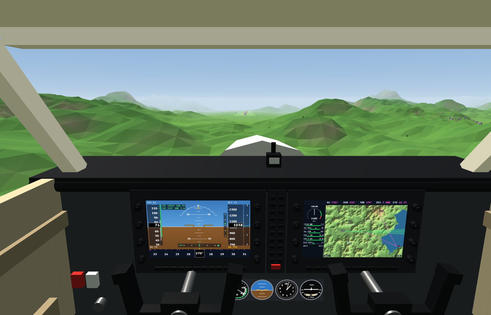
</p>

**[English](#english)** · **[Italiano](#italiano)**

**Play online / Gioca online: https://massimilianopetra.github.io/flightsimulator/**
(English: https://massimilianopetra.github.io/flightsimulator/?lang=en)

Manual / Manuale: [English](https://massimilianopetra.github.io/flightsimulator/istruzioni-en.html) ·
[Italiano](https://massimilianopetra.github.io/flightsimulator/istruzioni.html)

Code / Codice: https://github.com/massimilianopetra/flightsimulator

---

<a id="english"></a>

# English

A small flight simulator that runs in the browser, with realistic physics based on a **Cessna 172**
and Garmin G1000 avionics. You take off from a real runway, fly with glass-cockpit instruments,
navigate with VOR and ILS, and land following the PAPI lights. Missions (against the clock, tours,
precision landings) give each flight a goal, and the logbook keeps track of every flight.

The game and its manual are available in **Italian and English**: choose the language in the
briefing, or open `index.html?lang=en`. The choice is remembered.

## Screenshots

<p align="center">
  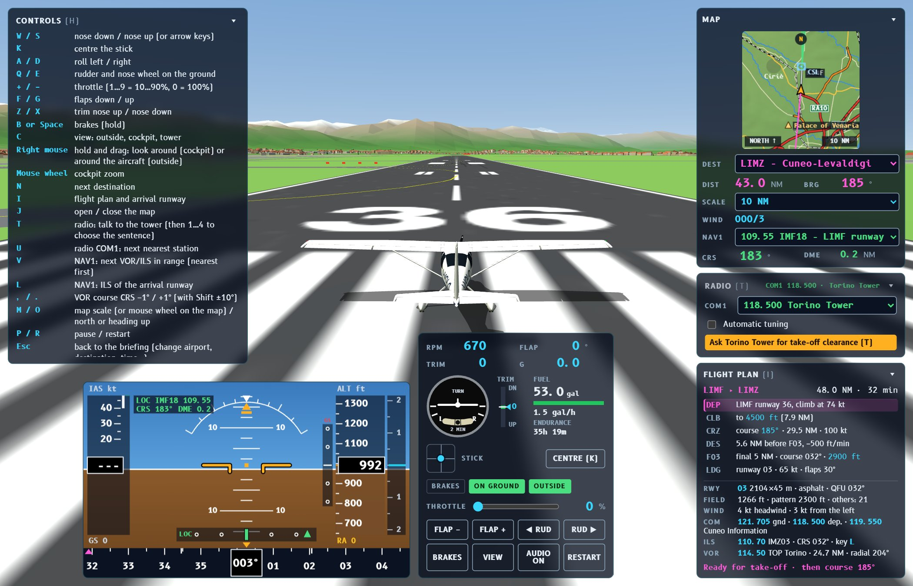
</p>

<table>
  <tr>
    <td width="55%">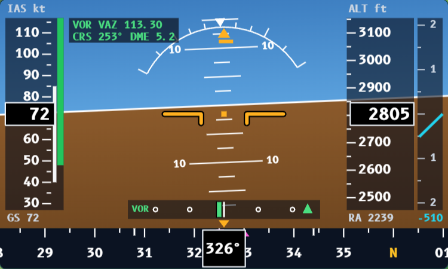</td>
    <td width="45%">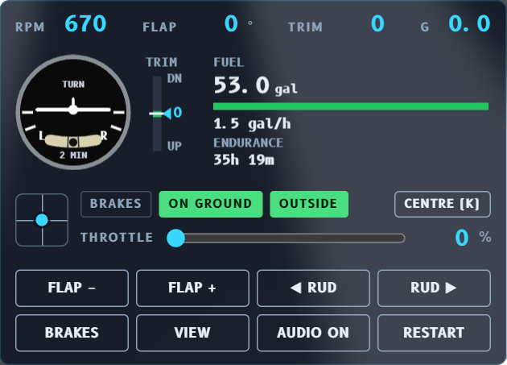</td>
  </tr>
  <tr>
    <td align="center"><sub>PFD on an ILS approach: localizer needle and glide slope diamond</sub></td>
    <td align="center"><sub>Engine panel: turn coordinator, trim, fuel and endurance</sub></td>
  </tr>
  <tr>
    <td>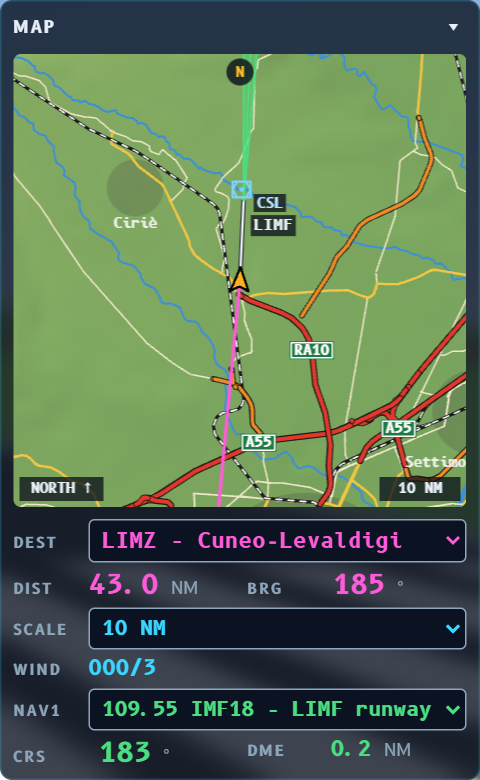</td>
    <td>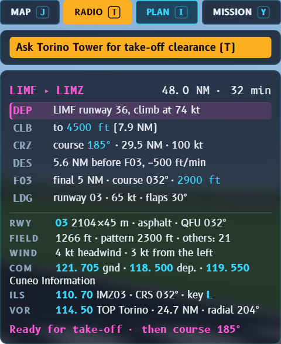</td>
  </tr>
  <tr>
    <td align="center"><sub>MAP tab: moving map with roads, airports and VORs</sub></td>
    <td align="center"><sub>PLAN tab: flight plan with ILS and VOR for the arrival</sub></td>
  </tr>
  <tr>
    <td>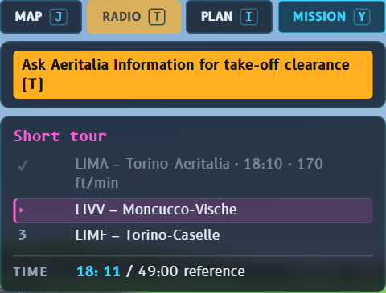</td>
    <td>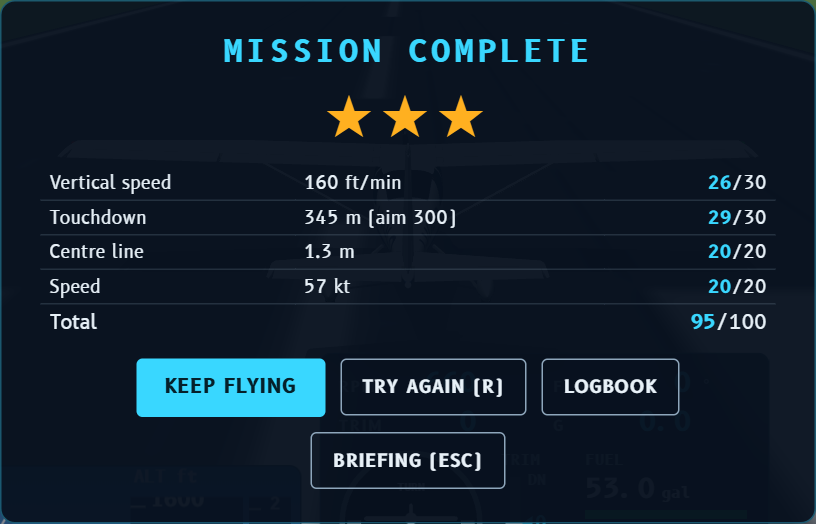</td>
  </tr>
  <tr>
    <td align="center"><sub>MISSION tab: a short tour after the first stop</sub></td>
    <td align="center"><sub>The result of a precision landing</sub></td>
  </tr>
</table>

<p align="center">
  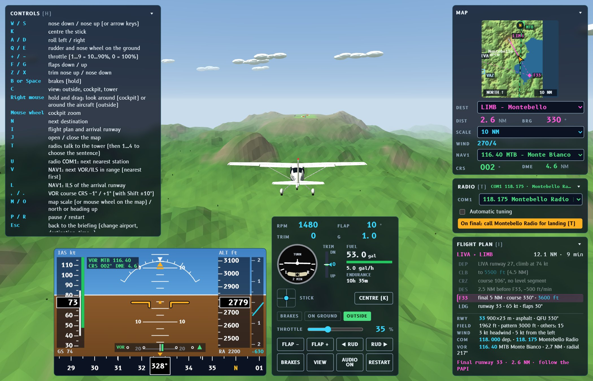
</p>

## The worlds

In the opening briefing you choose the **world**:

- **Piedmont (real)**, the default world: mountains, valleys and plains are the real ones, and so are
  32 airports with their ICAO codes and real runways (heading, length, width, grass or asphalt).
  There are also the lakes with their real shorelines (Maggiore, Orta, Viverone, Avigliana, Lugano,
  Como…), towns and villages with their buildings, motorways, roads, railways and rivers, and the real
  VOR radio beacons. From altitude you can see the Alps up to 70 km away.
  The main **monuments** are there as visual landmarks: Mole Antonelliana, Superga, the Lingotto with its rooftop test track, the two Turin skyscrapers, the Palace of Venaria, Stupinigi, the Sacra di San Michele, Vicoforte, San Gaudenzio in Novara and Oropa (simplified models, marked on the map).
- **Valle Azzurra (invented)**: the procedural world in `dati/mappa.js`, easy to edit by hand.

You can open a world directly from the address: `index.html?mappa=piemonte` or `index.html?mappa=valle`.

In the briefing you also choose the **departure airport** (with its real code, e.g. LIMF Turin-Caselle,
LIMZ Cuneo-Levaldigi, LIMC Milan-Malpensa), the **runway** (the one most into the wind is suggested),
the **start** (on the runway, or from the parking area with taxiing and ground radio), the **destination**, the **time of day** (day, sunset or night: at night runways, towns and the landing light are lit) and the **fuel** on board. The destination can be changed in flight from the map panel.

## How to start

Open `index.html` with a double click (Chrome, Edge or Firefox). An Internet connection is needed,
because the 3D library (three.js) and the fonts are downloaded from the Internet.

To work on it with VS Code the *Live Server* extension is fine too.

## Controls

| Key | Action |
|---|---|
| W / S (or arrows) | nose down / nose up: the stick moves while you hold the key and then stays there |
| K | centre the stick |
| A / D | roll |
| Q / E | rudder (on the ground it steers the nose wheel) |
| + / − | throttle; keys 1…9 set it to 10…90%, 0 to 100% |
| F / G | flaps down / up (0°, 10°, 20°, 30°) |
| Z / X | trim nose up / nose down |
| B or Space | brakes (hold) |
| C | view: outside, cockpit, tower |
| right mouse button (hold and drag) | look around in the cockpit, orbit the aircraft outside |
| mouse wheel | cockpit zoom (to read the screens) |
| N | next destination |
| J · T · I · Y | right column tabs: map, radio, flight plan, mission (press again to hide the column) |
| M (or mouse wheel over the map, or the SCALE menu) | map scale: 0.5, 1, 2, 5, 10, 20, 50, 100 NM or the whole region |
| O (or click on the map) | map with north up or heading up |
| T | radio: talk to the tower (then 1…4 to choose the sentence) |
| U | radio COM1: tune the next nearest station |
| V | NAV1 radio: next VOR or ILS in range (nearest first) |
| L | NAV1 radio: ILS of the arrival runway |
| , / . | VOR course (CRS) −1° / +1°, with Shift ±10° |
| P / R | pause / restart (the mission too) |
| Shift+A | autopilot on / off (when on: A/D heading, W/S altitude, Shift+W/S vertical speed, Shift+H current heading) |
| H | open or close the controls window (the flight pauses) |
| Esc | close the open window, otherwise back to the briefing |

The game never uses the Ctrl key (Ctrl+W would close the browser tab).

With the mouse you can drag on the screen as if it were a control stick. With both keys and mouse the
stick **stays in its last position** (the dot in the bottom panel shows where it is); K centres it. The rudder
returns to the centre by itself, like real pedals. In the CONTROLS window (H) you can set the **stick
sensitivity** (1–10: lower means softer controls near the centre) and make the stick **return to the
centre** when you release the keys. A gamepad works too: left stick for the control stick, right stick
for rudder and throttle, triggers for throttle, bumpers for flaps, A for brakes and Y for the view.

## How to fly (in short)

**Take-off**: flaps 10° (F), throttle 100% (0), stay on the centre line with Q/E;
at **55 knots** pull gently (S) to about 8° of pitch, then climb at **74 knots**.
Above 500 ft retract the flaps (G).

**Landing**: line up with the runway a few km out, flaps 30°, about **65 knots**.
The 4 PAPI lights on the left of the runway tell you whether you are on the right slope:
2 white and 2 red = correct, all white = too high, all red = too low.
Just above the runway close the throttle and raise the nose slightly (flare).
The landing gear survives touchdowns below 600–700 ft/min.

The **Practise landing** button in the briefing puts you straight on final approach to your destination.

**Taxiing**: choose *Start: from the parking area* in the briefing. You start on the apron; ask for taxi (T), follow the
yellow lines and the magenta route to the holding point, then call the tower: you line up and take off (or, if the
taxiway joins the runway half way, you backtrack to the threshold and turn around). Keep below 15 knots on the ground.
At 18 Italian airports of the Piedmont world (Caselle, Malpensa, Linate, Cuneo, Aosta, Genoa…) aprons and taxiways
are the real ones from OpenStreetMap, and the clearance names them (“taxi to holding point runway 36 via L, G”).

**Taking off again**: after landing, once you have stopped (on the apron if you started from the parking area), that airport
becomes the departure of the next flight: the flight plan is recalculated and the radio is ready for a new clearance.
Esc takes you back to the briefing at any time.

The full manual, with pictures of every instrument, explains the PFD, the turn coordinator,
VOR and ILS navigation and the emergencies step by step:
[English](https://massimilianopetra.github.io/flightsimulator/istruzioni-en.html).

## The screen and the missions

The screen keeps the view clear: at the **top left** two buttons open the controls window (H) and the
**logbook**; at the **top right** a single column with four tabs, **MAP** (J), **RADIO** (T), flight
**PLAN** (I), **AP** and **MISSION** (Y), of which only one shows at a time. When the radio tab is closed, the
last transmission and the tower prompt appear below the tabs, and the RADIO tab flashes when the tower
is waiting for you; T opens it by itself. At the bottom are the PFD and the engine panel.

In the briefing you can choose a **mission**, worth 0 to 3 stars (the objective and clock are shown at
the top centre):

- **against the clock**: land at the destination within a time limit worked out from the distance;
- **short / long tour**: 2 or 3 nearby airports picked at random, to touch in order (full stop or
  touch-and-go), then back home within a reference time;
- **precision landing**: you start on final and the touchdown is worth up to 100 points (vertical
  speed, aiming point, centre line, speed).

The **logbook** writes every flight by itself (from take-off until you stop): route, time, miles,
landings, missions and stars, with totals and records. It stays in the browser.

<p align="center">
  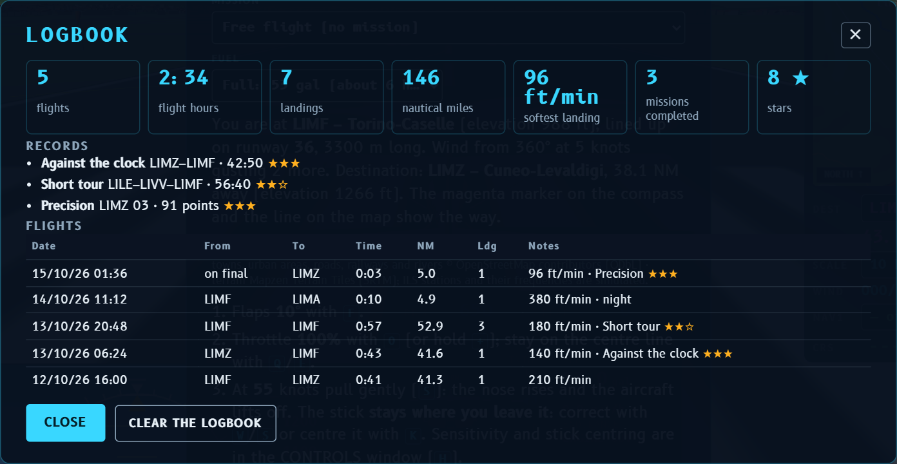
</p>

## Autopilot

Like the GFC 700 of today's G1000 Cessna 172, in a simple version: **Shift+A** engages it and it holds
the current heading (HDG) and altitude (ALT). With it engaged, A/D change the selected heading and W/S the
selected altitude: it then climbs or descends at the chosen vertical speed (VS, default 500 ft/min) and
captures the new altitude by itself. The throttle stays with the pilot; if the speed gets too low the
autopilot lowers the nose (MIN SPD). It also moves the trim, and it disconnects (with a tone) if you take
the stick, in a stall or with extreme attitudes. The mode bar is at the top of the PFD; the AP tab has the
same controls for the mouse.

<p align="center">
  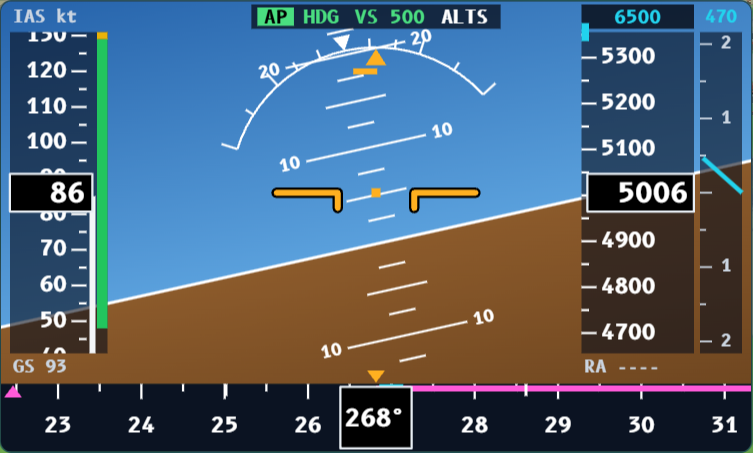
</p>

## Instruments

- **PFD**: airspeed with coloured bands, artificial horizon with bank scale and slip indicator,
  altitude with terrain and radio altimeter, vertical speed, compass with turn-rate trend,
  and the NAV1 indications (course deviation needle, TO/FROM, glide slope).
- **Engine panel**: RPM, flaps, trim (with a pointer), g-load, **turn coordinator**, **fuel**
  (gallons, consumption, endurance). The fuel really runs out: when the tanks are empty the engine stops.
- **Map** with the route, VOR stations, the selected course and the ILS beam.
- **G1000 cockpit** (view C): PFD and MFD screens, standby instruments (airspeed, attitude,
  altimeter, turn coordinator), moving yokes, throttle, flap lever and trim wheel.

## Radio navigation: VOR and ILS

The NAV1 receiver can tune **VOR** stations (with DME distance) and **ILS** approaches.
In the Piedmont world the VORs are the real ones (from OurAirports), for example TOP Torino 114.50.
The ILS stations are created by the simulator on every asphalt runway at least 1000 m long:
**their frequencies are invented**. Stations are only received within line of sight, so the higher
you fly the further they reach. The simulator uses true north, not magnetic north.

## Radio communications

The tower talks to you in **English**, with the standard ICAO phraseology, using the browser's speech synthesis.
You do not speak: press **T**, choose the sentence (1…4) and the game says it with the pilot's voice. Clearances must be
read back, and sometimes one of the answers is deliberately wrong: the tower corrects you. Take-off, leaving the control
zone, arrival (visual or ILS), final, landing, vacating the runway and MAYDAY are covered. In the Piedmont world the stations
and frequencies are the real ones from OurAirports (e.g. Torino Ground 121.705, Torino Tower 118.500, Cuneo Information
119.550); airports without data get a simulated station.
You tune the COM1 radio yourself (COM1 menu or U key): on the wrong frequency nobody answers. Tick "Automatic tuning" to let
the game do it.

## The flight plan

Below the map there is the **flight plan** to the chosen destination, as a VFR pilot would prepare it:

1. **DEP** – take-off from the departure runway;
2. **CLB** – climb to cruising altitude (at 74 knots, about 550 ft/min);
3. **CRZ** – cruise: course, distance and altitude. The altitude is computed from the real terrain
   along the route (at least 1000 ft above the highest point) and follows the VFR rule: eastbound odd
   thousands + 500 ft (3500, 5500...), westbound even thousands + 500 ft (4500, 6500...);
4. **DES** – where to start the descent (at 500 ft/min);
5. **F..** – the **final approach point**, 5 NM before the runway in use, lined up with it, at the right
   height for the 3° slope;
6. **LDG** – landing: 65 knots, flaps 30°.

The **runway in use** is the one most into the wind; the panel shows its length, width, surface,
heading (QFU), field elevation, pattern altitude, the headwind and crosswind, the ILS frequency and the
VOR nearest to the destination. During the flight the current phase is highlighted and the last line tells
you what to do next. The magenta marker on the compass, DIST/BRG and the line on the map lead **first to the
final approach point and then to the runway**, so you arrive already lined up.

## What is “real” in the physics

- Lift, drag (including induced drag, which decreases near the ground) and side force computed with the
  aerodynamic coefficients of the C172.
- Stability and control moments: the aircraft is stable by itself, has a phugoid (it slowly oscillates up
  and down if you leave it), turns in a coordinated way and has adverse yaw.
- Stall at about 48 knots (40 with flaps): the nose drops and a wing may drop too.
- Propeller thrust that decreases with speed and altitude (thinner air).
- Fuel consumption depending on the throttle; with empty tanks the engine stops.
- Landing gear with springs and dampers, different friction on asphalt and grass, brakes, nose-wheel steering.
- Wind with gusts, weaker near the ground.
- Structural limits: too much speed or too many g break the aircraft.

## Publishing on GitHub Pages

The site is published at **https://massimilianopetra.github.io/flightsimulator/**
and is served from the `gh-pages` branch of the repository.

**Only the first time** (or on a new computer, after `git clone`):

```
npm install
```

**Every time you want to update the site**, from the project folder:

```
git add -A
git commit -m "describe what you changed"
git push
npm run deploy
```

- `git push` saves the code in the `main` branch on GitHub.
- `npm run deploy` copies the game files (`index.html`, the manuals, `css/`, `js/`, `dati/`, `icone/`,
  `istruzioni/`) to the `gh-pages` branch, and GitHub Pages publishes them.
- After about a minute the site is updated. If you still see the old version, reload with **Ctrl+F5**.

The site needs no build step: it is made of static files.

## The files

| File | What it contains | Edit it? |
|---|---|---|
| `dati/mappa.js` | the **invented** world (Valle Azzurra): hills, mountains, lakes, airports and runways, VORs, towns, woods, weather, starting point | **yes, that is what it is for** |
| `dati/piemonte.js` | the **real** world: airports and runways, lakes, towns, weather, start (generated) | yes (weather, start, colours) |
| `dati/piemonte-rilievo.js` | real terrain heights, 250 m grid (generated, do not edit by hand) | no |
| `dati/piemonte-vie.js` | motorways, main and local roads, village streets, railways, rivers and large canals (generated) | no |
| `dati/piemonte-abitati.js` | residential and industrial areas and the density of real buildings in 100 m squares (generated) | no |
| `dati/piemonte-radio.js` | the real VORs and airport radio frequencies (generated) | no |
| `dati/piemonte-rullaggio.js` | the real taxiways and aprons of 18 airports (generated) | no |
| `dati/piemonte-monumenti.js` | position and orientation of the monuments | yes |
| `dati/aereo.js` | the aircraft data: weight, engine, fuel, wing, aerodynamic coefficients, landing gear | yes, to experiment |
| `strumenti/genera-piemonte.js` | the script that downloads the real data and creates the Piedmont files | |
| `strumenti/genera-radio.js` | the script that creates the list of real VORs and airport frequencies | |
| `strumenti/genera-rullaggio.js` | the script that extracts the taxiways and aprons from OpenStreetMap | |
| `strumenti/leggi-pbf.js` | a small reader for OpenStreetMap `.osm.pbf` files, used by the generator | |
| `js/lingua.js` | Italian / English: language choice and translation of the page | |
| `js/terreno.js` | computes the terrain height and builds the mesh that follows the aircraft | |
| `js/paesaggio.js` | draws roads, rivers and towns on the terrain and generates the buildings (real map only) | |
| `js/fisica.js` | the flight physics (forces, moments, landing gear, stall, ground effect, fuel) | |
| `js/cabina.js` | the 3D G1000-style cockpit: PFD and MFD screens, standby instruments, yokes, throttle | |
| `js/mondo.js` | 3D graphics: sky, runways with markings, PAPI, hangars, trees, houses, aircraft and its shadow near the ground | |
| `js/notte.js` | time of day: sky and light colours, runway, town and landing lights, stars | |
| `js/strumenti.js` | PFD, turn coordinator, fuel and trim indicators, MFD and the map | |
| `js/radio.js` | radio navigation: VOR, DME and ILS, the NAV1 receiver | |
| `js/rullaggio.js` | taxiways: network, shortest route from the apron to the holding point, drawing | |
| `js/atc.js` | radio communications with the tower (speech synthesis, menu of answers) | |
| `js/monumenti.js` | the 3D models of the monuments | |
| `js/piano.js` | flight plan to the destination and arrival runway information | |
| `js/audio.js` | synthesised sounds: engine, wind, stall horn | |
| `js/autopilota.js` | the autopilot: heading, altitude and vertical speed, speed protection, auto-trim | |
| `js/missioni.js` | missions: against the clock, tours, precision landing; stars and result | |
| `js/libretto.js` | the logbook: every flight saved in the browser, totals and records | |
| `js/main.js` | ties everything together: controls, cameras, messages, main loop | |
| `css/stile.css` | the look of the panels | |
| `istruzioni.html`, `istruzioni-en.html`, `istruzioni/` | the manual in Italian and English, with pictures taken from the game | |
| `icone/` | the site icon (`favicon.svg`, from which the PNG versions are made) | |

The code comments and the comments in `dati/mappa.js` are in Italian.

## The real map of Piedmont

On the Piedmont map there are also **roads, railways and rivers**, useful for finding your way by sight:
motorways in red with their number on a green sign (A4, A6, A21, A32, A55...), expressways in orange,
main roads in yellow, provincial roads in a light colour (only from 20 NM down), railways as black
dashes and rivers in blue, with the Po thicker.

The same features are also visible **in the 3D landscape**, with realistic colours: grey asphalt,
dual-carriageway motorways with the central barrier, railway ballast, rivers with water and gravel banks.
They are drawn on an image (about 5 m per pixel) that the nearby terrain “wears”, so they follow every
rise and dip exactly.

**Towns and villages** are real too. From OpenStreetMap the generator extracts residential and industrial
areas and, for every 100 m square, how much of it is covered by buildings (about 2.7 million buildings in
all). The game fills those squares with generated buildings: houses with tiled roofs in villages, taller and
denser blocks towards the centre of large towns, sheds in industrial areas. Each building faces the nearest
road and keeps clear of roads, railways and rivers. Near the aircraft they are 3D (up to 100,000), further
away they are drawn on the ground.

The Piedmont data files are created by the script

```
node strumenti/genera-piemonte.js
```

which downloads the data from the Internet (the first time also the OpenStreetMap extract of north-west
Italy, about 600 MB: it takes a few minutes; afterwards everything stays in `strumenti/cache/`, which is not
uploaded to GitHub). At the top of the script you can change the **area** (latitudes and longitudes), the
**step** of the height grid and the list of lakes and towns. Note: running it again rewrites
`dati/piemonte.js`, so manual changes (for example the weather) must be redone, or put directly into the script.
The VOR list is created separately and quickly with `node strumenti/genera-radio.js`.

In `dati/piemonte.js` you can change without regenerating: weather and visibility, departure airport
and runway, destination, terrain colours by height, and add or correct airports.

**Data sources** (to be credited if the project is shown or published):
- airports, runways, VORs and radio frequencies: [OurAirports](https://ourairports.com/data/), public domain;
- lakes and towns: © [OpenStreetMap](https://www.openstreetmap.org/copyright) contributors, ODbL licence;
- roads, railways, rivers and taxiways: © OpenStreetMap contributors (ODbL), from the north-west extract by [Geofabrik](https://download.geofabrik.de/europe/italy.html);
- terrain heights: [Mapzen Terrain Tiles](https://registry.opendata.aws/terrain-tiles/) (SRTM, GMTED and others).

Peaks come out about 150–250 m lower than in reality (Monviso is ~3650 m instead of 3841),
because the 250 m grid smooths the summits. It makes no difference for flying.

### At night

<table>
  <tr>
    <td colspan="2">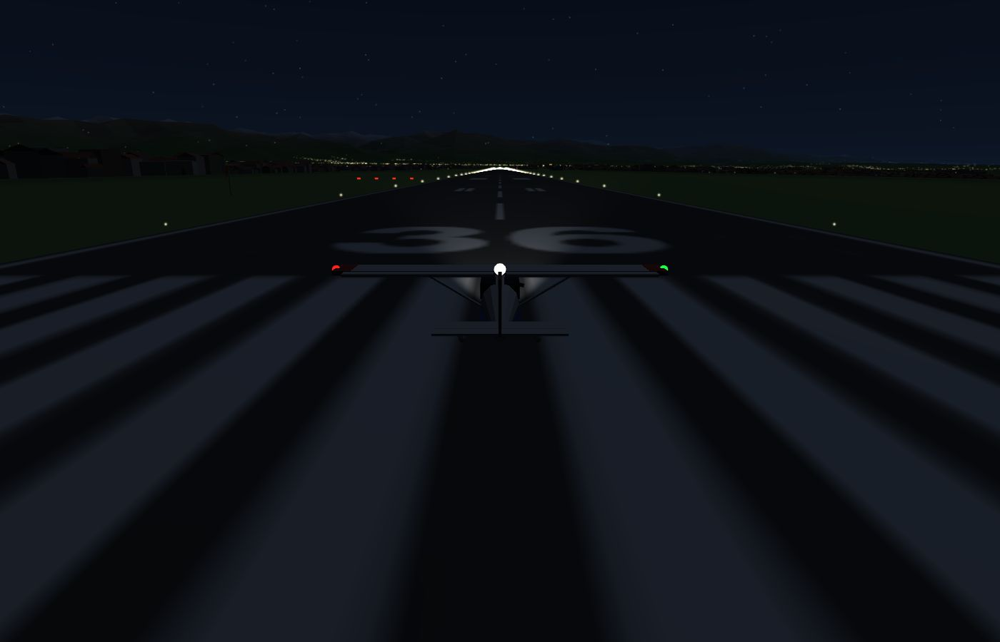</td>
  </tr>
  <tr>
    <td colspan="2" align="center"><sub>Runway 36 at Turin-Caselle at night: edge lights, PAPI, stars and the landing light</sub></td>
  </tr>
  <tr>
    <td width="50%">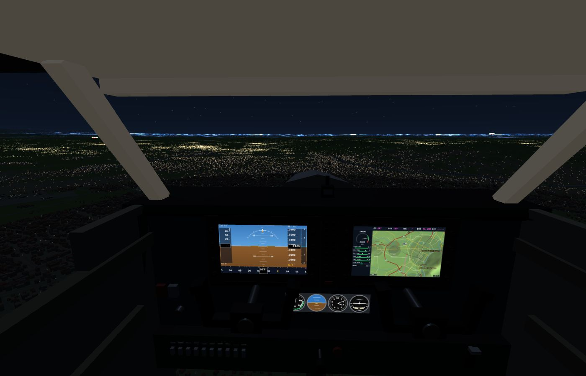</td>
    <td width="50%">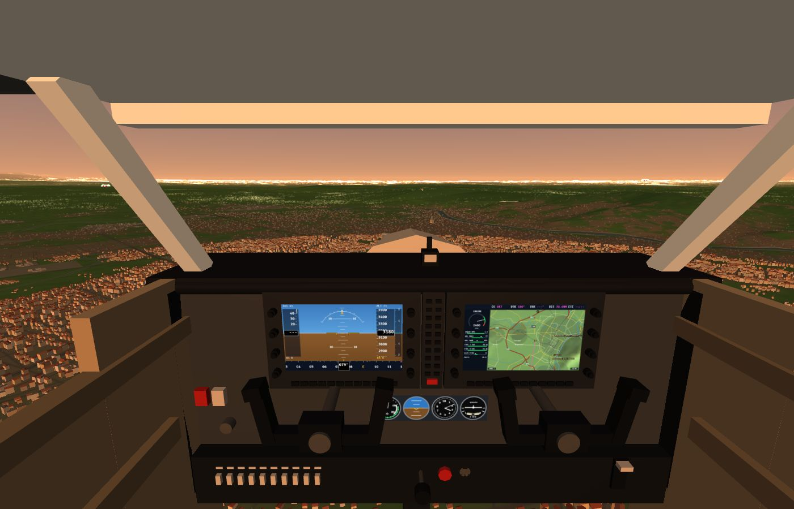</td>
  </tr>
  <tr>
    <td align="center"><sub>Turin at night: the town lights come from the real buildings</sub></td>
    <td align="center"><sub>The same flight at sunset</sub></td>
  </tr>
</table>

### The monuments

<table>
  <tr>
    <td width="50%">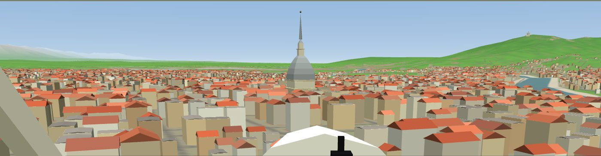</td>
    <td width="50%">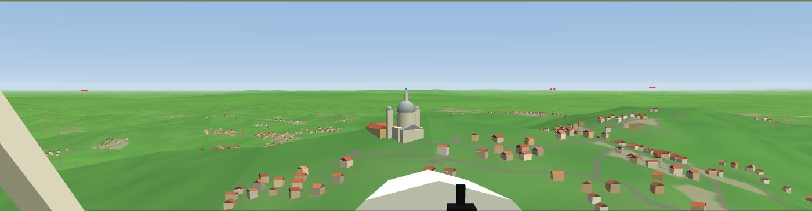</td>
  </tr>
  <tr>
    <td align="center"><sub>Mole Antonelliana · Turin</sub></td>
    <td align="center"><sub>Superga Basilica · on the Turin hill</sub></td>
  </tr>
  <tr>
    <td width="50%">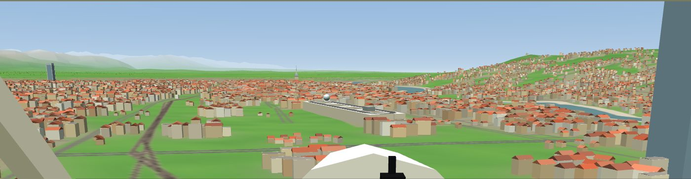</td>
    <td width="50%">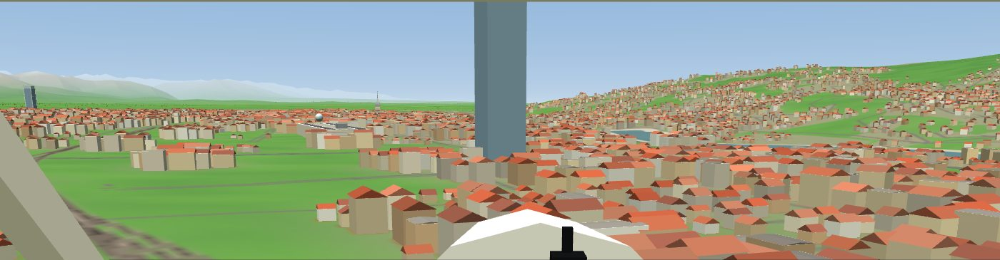</td>
  </tr>
  <tr>
    <td align="center"><sub>Lingotto · with the rooftop track and the Bubble</sub></td>
    <td align="center"><sub>Piedmont Region Tower · 209 m</sub></td>
  </tr>
  <tr>
    <td width="50%">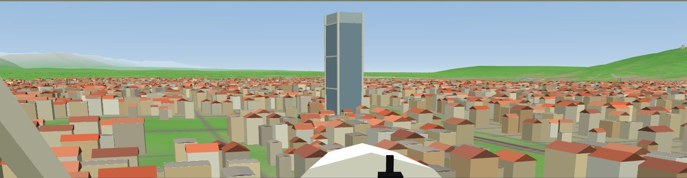</td>
    <td width="50%">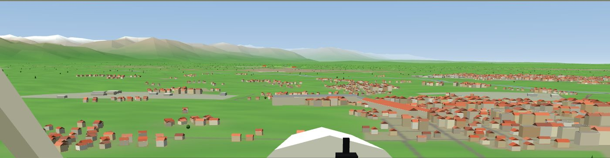</td>
  </tr>
  <tr>
    <td align="center"><sub>Intesa Sanpaolo Tower · 166 m</sub></td>
    <td align="center"><sub>Palace of Venaria · simplified model</sub></td>
  </tr>
  <tr>
    <td width="50%">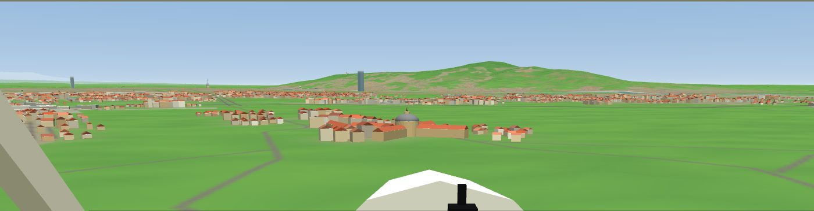</td>
    <td width="50%">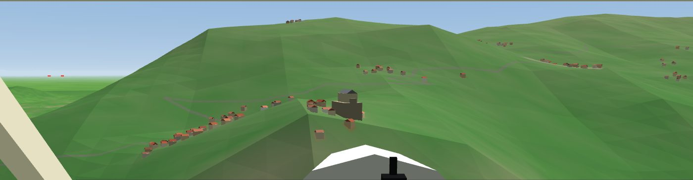</td>
  </tr>
  <tr>
    <td align="center"><sub>Stupinigi Hunting Lodge · with the stag on the dome</sub></td>
    <td align="center"><sub>Sacra di San Michele Abbey · on Mount Pirchiriano</sub></td>
  </tr>
  <tr>
    <td width="50%">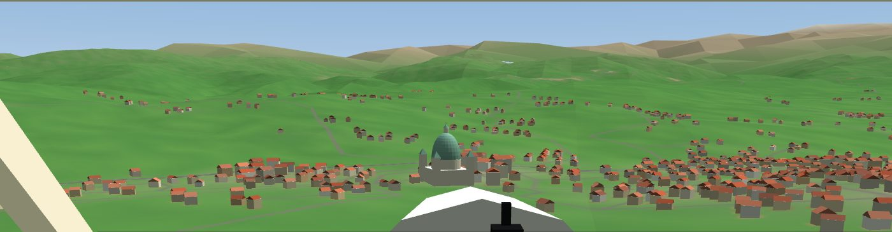</td>
    <td width="50%">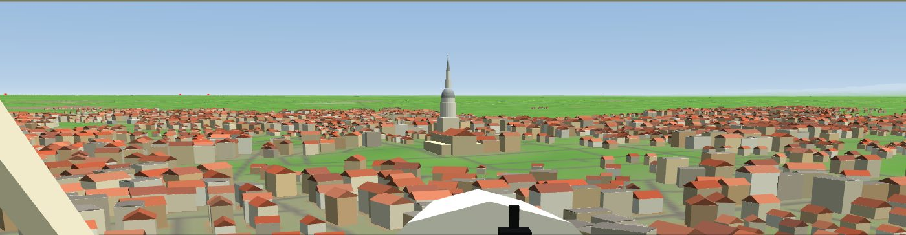</td>
  </tr>
  <tr>
    <td align="center"><sub>Sanctuary of Vicoforte · the great elliptical dome</sub></td>
    <td align="center"><sub>Basilica of San Gaudenzio · Novara, 121 m</sub></td>
  </tr>
  <tr>
    <td width="50%">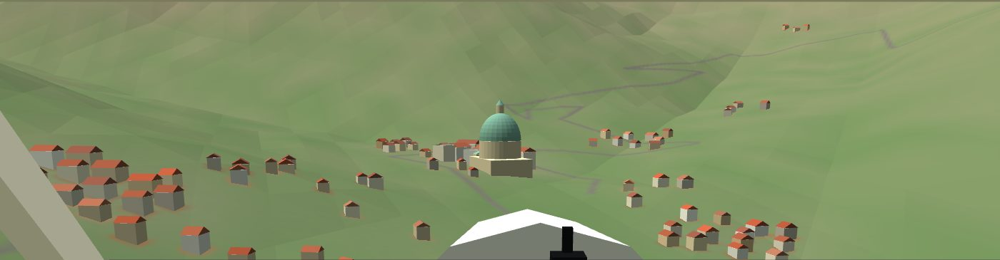</td>
  </tr>
  <tr>
    <td align="center"><sub>Sanctuary of Oropa · Biella</sub></td>
  </tr>
</table>

## Editing the invented map

Everything is done in `dati/mappa.js`. The rules:

- coordinates are in **metres**: `x` towards **east**, `y` towards **north**, and `(0, 0)` is the centre;
- directions are **compass degrees** (0 = north, 90 = east, 180 = south, 270 = west);
- heights are in metres above sea level; for airports and lakes you can write `quota: "auto"`.

After each change save and reload the page (F5). If the page stays empty, press F12 and look at the
console: usually a comma is missing. The property names are Italian (`codice` = code, `nome` = name,
`piste` = runways, `direzione` = heading, `lunghezza` = length, `larghezza` = width, `quota` = elevation,
`raggio` = radius, `altezza` = height, `vento` = wind, `partenza` = start).

Add an airport with two crossing runways:

```js
{
  codice: "LINU", nome: "Nuovo Campo",
  x: 5000, y: -4000, quota: "auto",
  piste: [
    { direzione: 90,  lunghezza: 1200, larghezza: 30 },
    { direzione: 180, lunghezza: 800,  larghezza: 23, spostamentoEst: 500 },
  ],
},
```

The runway numbers are computed by themselves: heading 90 gives runways “09” and “27”. Next to the first
runway an apron, hangars, a tower, a windsock and PAPI lights appear automatically. Asphalt runways of at
least 1000 m also get an ILS.

Add a mountain (or a valley, with a negative `altezza`):

```js
{ nome: "Pizzo Nero", x: -3000, y: 8000, raggio: 2000, altezza: 1200 },
```

Add a VOR:

```js
{ id: "NEW", nome: "Nuovo VOR", freq: 114.20, x: 6000, y: 3000, dme: true },
```

Change the weather (for example a crosswind, to practise):

```js
meteo: { ventoDa: 0, ventoNodi: 12, raffiche: 6, nuvole: 60, baseNuvole: 900 },
```

Start from another runway, or directly in flight:

```js
partenza: { aeroporto: "LIPM", pista: "09" },
partenza: { x: 0, y: -3000, quota: 800, direzione: 0, velocitaNodi: 100 },
```

With `terreno.seme` you get a completely different landscape: in that case check that the airports
do not end up in the sea.

## Ideas for the next steps

- More aircraft (a glider? a jet?): just another file like `dati/aereo.js`.

## Licence

Copyright © 2026 Massimiliano Petra

This program is free software: you can redistribute it and/or modify it under the terms of the
**GNU General Public License version 3** as published by the Free Software Foundation, or (at your
option) any later version. It is distributed in the hope that it will be useful, but **without any
warranty**. The full text is in the [LICENSE](LICENSE) file.

The real Piedmont data in the `dati/piemonte*.js` files keep the licences of their sources:
OurAirports (public domain), © OpenStreetMap contributors (ODbL), Mapzen Terrain Tiles (see the sources above).

This simulator is a game: do not use it for real navigation.

---

<a id="italiano"></a>

# Italiano

Un piccolo simulatore di volo nel browser, con fisica realistica ispirata a un **Cessna 172**
con avionica Garmin G1000: si decolla da una pista vera, si vola con strumenti da glass cockpit,
si naviga con VOR e ILS e si atterra seguendo le luci PAPI. Le missioni (a tempo, giri a tappe,
atterraggi di precisione) danno uno scopo a ogni volo e il libretto di volo li ricorda tutti.

Il gioco e il manuale sono in **italiano e in inglese**: la lingua si sceglie nel briefing, oppure
aprendo `index.html?lang=en`. La scelta viene ricordata.

## Immagini

<p align="center">
  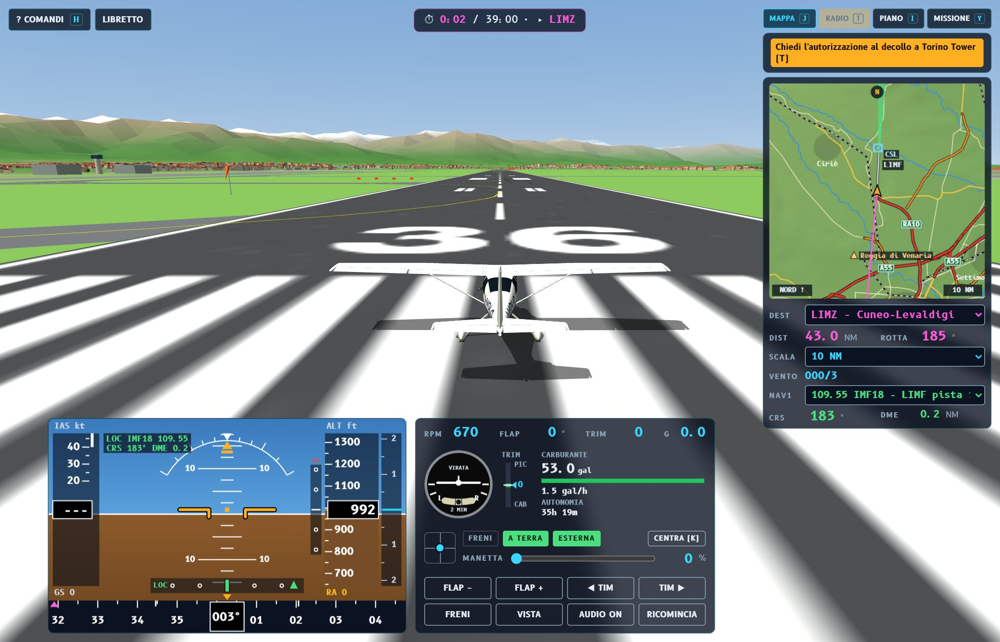
</p>

<table>
  <tr>
    <td width="55%">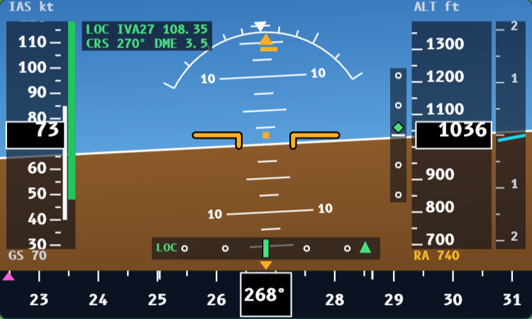</td>
    <td width="45%">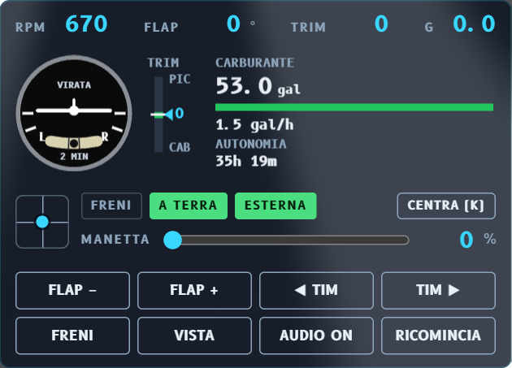</td>
  </tr>
  <tr>
    <td align="center"><sub>PFD in avvicinamento ILS: ago del localizzatore e rombo del sentiero di discesa</sub></td>
    <td align="center"><sub>Pannello motore: virosbandometro, trim, carburante e autonomia</sub></td>
  </tr>
  <tr>
    <td>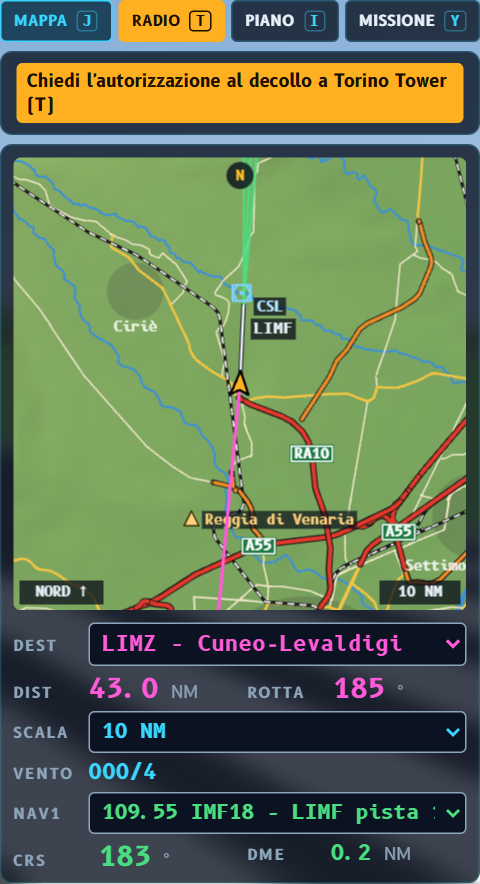</td>
    <td>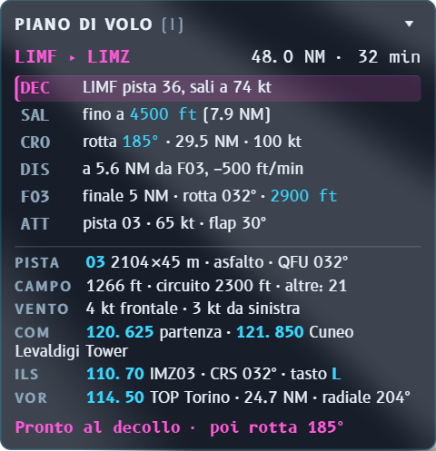</td>
  </tr>
  <tr>
    <td align="center"><sub>Scheda MAPPA: mappa mobile con strade, aeroporti e VOR</sub></td>
    <td align="center"><sub>Scheda PIANO: piano di volo con ILS e VOR per l'arrivo</sub></td>
  </tr>
  <tr>
    <td>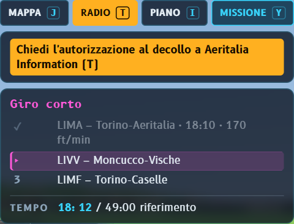</td>
    <td>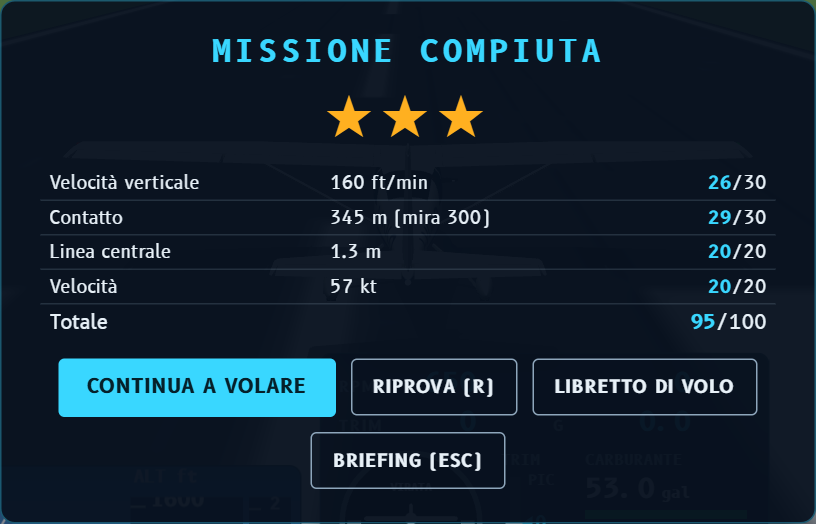</td>
  </tr>
  <tr>
    <td align="center"><sub>Scheda MISSIONE: un giro corto dopo la prima tappa</sub></td>
    <td align="center"><sub>Il risultato di un atterraggio di precisione</sub></td>
  </tr>
</table>

<p align="center">
  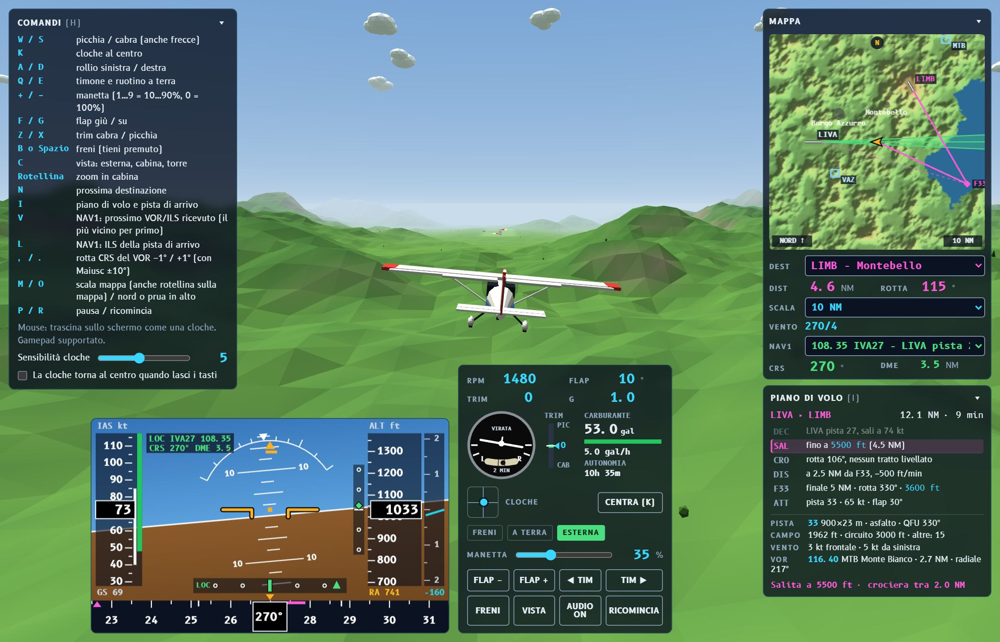
</p>

## I mondi

Nel briefing iniziale si sceglie il **mondo**:

- **Piemonte (reale)**, il mondo predefinito: le montagne, le valli e la pianura sono quelle vere,
  e così 32 aeroporti con le loro sigle ICAO e le piste reali (direzione, lunghezza,
  larghezza, erba o asfalto). Ci sono anche i laghi con il loro contorno (Maggiore, Orta,
  Viverone, Avigliana, Lugano, Como…), città e paesi con i loro edifici, autostrade, strade,
  ferrovie e fiumi, e i radiofari VOR veri. Dall'alto si vedono le Alpi fino a 70 km di distanza.
  Ci sono anche i principali **monumenti**, utili come riferimento a vista: la Mole Antonelliana, Superga, il Lingotto con la pista sul tetto, i due grattacieli di Torino, la Reggia di Venaria, Stupinigi, la Sacra di San Michele, Vicoforte, San Gaudenzio a Novara e Oropa (modelli semplificati, segnati sulla mappa).
- **Valle Azzurra (inventata)**: il mondo procedurale di `dati/mappa.js`, comodo da modificare a mano.

Si può aprire direttamente un mondo dall'indirizzo: `index.html?mappa=piemonte` oppure `index.html?mappa=valle`.

Nel briefing si scelgono anche l'**aeroporto di partenza** (con la sigla vera, es. LIMF Torino-Caselle,
LIMZ Cuneo-Levaldigi, LIMC Milano-Malpensa), la **pista** (viene proposta quella più controvento),
la **partenza** (in pista, oppure dal parcheggio con il rullaggio e la radio a terra), la **destinazione**, l'**ora del volo** (giorno, tramonto o notte: di notte si accendono piste, città e faro di atterraggio) e il **carburante** a bordo. La destinazione si può cambiare in volo dal menu nel
pannello della mappa.

## Come si avvia

Apri `index.html` con un doppio clic (Chrome, Edge o Firefox).
Serve la connessione a Internet, perché la libreria 3D (three.js) e i font
vengono scaricati da Internet.

Per lavorarci con VS Code va bene anche l'estensione *Live Server*.

## Comandi

| Tasto | Azione |
|---|---|
| W / S (o frecce) | picchia / cabra: la cloche si sposta finché tieni premuto e poi resta lì |
| K | riporta la cloche al centro |
| A / D | rollio |
| Q / E | timone (a terra sterza il ruotino anteriore) |
| + / − | manetta; i tasti 1…9 la mettono al 10…90%, 0 al 100% |
| F / G | flap giù / su (0°, 10°, 20°, 30°) |
| Z / X | trim cabra / picchia |
| B o Spazio | freni (tieni premuto) |
| C | vista: esterna, cabina, torre |
| tasto destro del mouse (tieni premuto e trascina) | guardarsi intorno in cabina, girare attorno all'aereo fuori |
| rotellina del mouse | zoom in cabina (per leggere gli schermi) |
| N | prossima destinazione |
| J · T · I · Y | schede della colonna di destra: mappa, radio, piano di volo, missione (di nuovo per nascondere la colonna) |
| M (o rotellina sopra la mappa, o il menu SCALA) | scala della mappa: 0,5, 1, 2, 5, 10, 20, 50, 100 NM o tutta la regione |
| O (o clic sulla mappa) | mappa con il nord in alto oppure con la prua in alto |
| T | radio: parla con la torre (poi 1…4 per scegliere la frase) |
| U | radio COM1: sintonizza la prossima stazione vicina |
| V | radio NAV1: prossimo VOR o ILS ricevuto (il più vicino per primo) |
| L | radio NAV1: ILS della pista di arrivo |
| , / . | rotta del VOR (CRS) −1° / +1°, con Maiusc ±10° |
| P / R | pausa / ricomincia (anche la missione) |
| Maiusc+A | autopilota sì / no (inserito: A/D prua, W/S quota, Maiusc+W/S velocità verticale, Maiusc+H prua attuale) |
| H | apre o chiude la finestra dei comandi (il volo va in pausa) |
| Esc | chiude la finestra aperta, altrimenti torna al briefing |

Il gioco non usa mai il tasto Ctrl (Ctrl+W chiuderebbe la scheda del browser).

Col mouse si può trascinare sullo schermo come se fosse una cloche. Sia con i tasti sia col mouse la
cloche **resta nell'ultima posizione** (il pallino nel pannello in basso mostra dov'è); K la riporta al centro.
Il timone invece torna al centro da solo, come i pedali veri. Nella finestra COMANDI (H) si regolano la
**sensibilità della cloche** (1–10: più bassa = comandi più dolci vicino al centro) e il **ritorno al
centro** della cloche quando lasci i tasti. Funziona anche un gamepad: stick sinistro per la cloche,
stick destro per timone e manetta, grilletti per la manetta, dorsali per i flap, A per i freni e Y per la vista.

## Come si vola (in breve)

**Decollo**: flap 10° (F), manetta al 100% (0), resta sulla linea centrale con Q/E;
a **55 nodi** tira dolcemente (S) fino a circa 8° di assetto, poi sali a **74 nodi**.
Sopra i 500 ft retrai i flap (G).

**Atterraggio**: allineati alla pista da qualche km di distanza, flap 30°, circa **65 nodi**.
Le 4 luci PAPI a sinistra della pista dicono se sei sulla pendenza giusta:
2 bianche e 2 rosse = giusto, tutte bianche = troppo alto, tutte rosse = troppo basso.
Poco sopra la pista togli motore e alza leggermente il muso (richiamata).
Sotto 600–700 ft/min di discesa al contatto il carrello resiste.

Il pulsante **Prova l'atterraggio** del briefing ti mette già in finale sulla destinazione.

**Rullaggio**: nel briefing scegli *Partenza: dal parcheggio*. Parti dal piazzale; chiedi di rullare (T), segui le linee
gialle e la rotta magenta fino al punto attesa, poi chiama la torre: ti allinei e decolli (oppure, se la via entra a metà
pista, la risali fino alla testata e ti giri). A terra resta sotto i 15 nodi.
In 18 aeroporti italiani del mondo Piemonte (Caselle, Malpensa, Linate, Cuneo, Aosta, Genova…) piazzali e vie di
rullaggio sono quelli veri di OpenStreetMap, e l'autorizzazione li nomina (“taxi to holding point runway 36 via L, G”).

**Ripartire**: dopo l'atterraggio, quando sei fermo (sul piazzale, se eri partito dal parcheggio), quell'aeroporto diventa la
partenza del volo successivo: il piano di volo viene ricalcolato e la radio è pronta per una nuova autorizzazione.
Esc ti riporta al briefing in qualsiasi momento.

Il manuale completo, con le immagini di tutti gli strumenti, spiega passo passo il PFD, il
virosbandometro, la navigazione VOR e ILS e le emergenze:
[Italiano](https://massimilianopetra.github.io/flightsimulator/istruzioni.html).

## Lo schermo e le missioni

Lo schermo lascia libera la vista: **in alto a sinistra** due pulsanti aprono la finestra dei comandi (H)
e il **libretto di volo**; **in alto a destra** c'è una sola colonna con quattro schede, **MAPPA** (J),
**RADIO** (T), **PIANO** di volo (I), **AP** e **MISSIONE** (Y), e se ne vede una alla volta. Con la radio
chiusa, l'ultima trasmissione e l'avviso della torre compaiono sotto le linguette, e la linguetta RADIO
lampeggia quando la torre ti aspetta; T la apre da sola. In basso restano il PFD e il pannello motore.

Nel briefing si può scegliere una **missione**, che vale da 0 a 3 stelle (obiettivo e cronometro in alto
al centro):

- **a tempo**: atterrare alla destinazione entro un tempo limite calcolato dalla distanza;
- **giro corto / lungo**: 2 o 3 aeroporti vicini scelti a caso, da toccare in ordine (atterraggio
  completo o tocca e riparti), poi il ritorno a casa entro un tempo di riferimento;
- **atterraggio di precisione**: si parte in finale e il contatto vale fino a 100 punti (velocità
  verticale, punto di mira, linea centrale, velocità).

Il **libretto di volo** scrive da solo ogni volo (dal decollo a quando ti fermi): rotta, durata, miglia,
atterraggi, missioni e stelle, con i totali e i record. Resta nel browser.

<p align="center">
  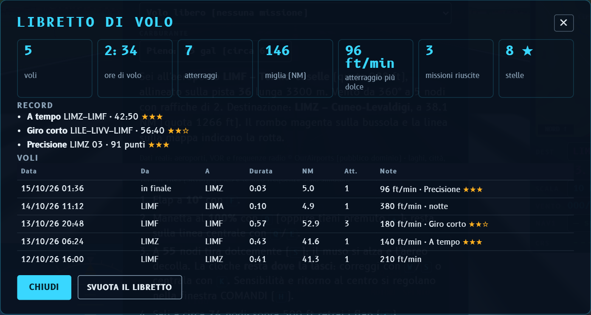
</p>

## Autopilota

Come il GFC 700 del Cessna 172 con G1000 di oggi, in versione semplice: **Maiusc+A** lo inserisce e tiene
la prua (HDG) e la quota (ALT) attuali. Inserito, A/D cambiano la prua scelta e W/S la quota scelta: allora
sale o scende alla velocità verticale scelta (VS, di serie 500 ft/min) e aggancia da solo la nuova quota.
La manetta resta al pilota; se la velocità scende troppo l'autopilota abbassa il muso (VEL MIN). Muove anche
il trim e si stacca (con un segnale acustico) se prendi la cloche, in stallo o con assetti estremi. La barra
dei modi è in alto nel PFD; la scheda AP ha gli stessi comandi per il mouse.

<p align="center">
  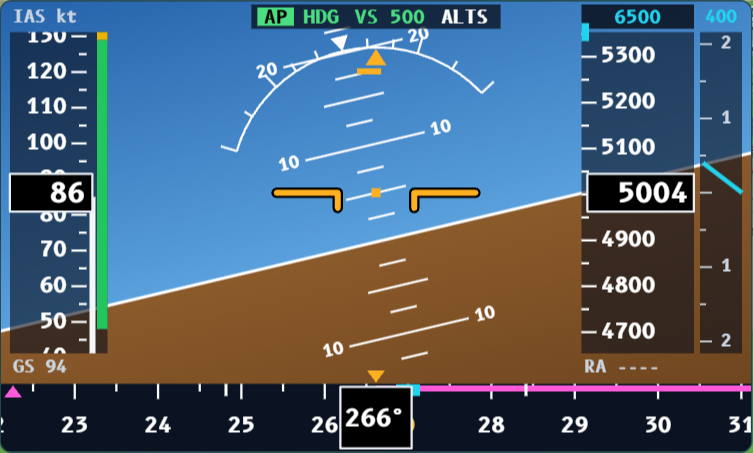
</p>

## Strumenti

- **PFD**: velocità con le fasce colorate, orizzonte artificiale con scala di inclinazione e indicatore
  di sbandamento, quota con il terreno e il radioaltimetro, variometro, bussola con il vettore di virata,
  e le indicazioni NAV1 (ago di deviazione, TO/FROM, sentiero di discesa).
- **Pannello motore**: giri, flap, trim (con lancetta), g, **virosbandometro**, **carburante**
  (galloni, consumo, autonomia). Il carburante finisce davvero: a serbatoi vuoti il motore si spegne.
- **Mappa** con la rotta, le stazioni VOR, la rotta selezionata e il fascio dell'ILS.
- **Cabina G1000** (vista C): schermi PFD e MFD, strumenti di riserva (anemometro, orizzonte,
  altimetro, virosbandometro), cloche, manetta, leva dei flap e ruota del trim che si muovono.

## Radionavigazione: VOR e ILS

Il ricevitore NAV1 sintonizza le stazioni **VOR** (con la distanza DME) e gli avvicinamenti **ILS**.
Nel mondo Piemonte i VOR sono quelli veri (da OurAirports), per esempio TOP Torino 114.50.
Gli ILS li crea il simulatore su tutte le piste asfaltate di almeno 1000 m: **le loro frequenze sono
inventate**. Le stazioni si ricevono solo in linea di vista, quindi più si vola alti più arrivano lontano.
Il simulatore usa il nord geografico, non quello magnetico.

## Comunicazioni radio

La torre ti parla in **inglese**, con la fraseologia standard ICAO, usando la sintesi vocale del browser.
Tu non parli: premi **T**, scegli la frase (1…4) e il gioco la pronuncia con la voce del pilota; sotto ogni frase c'è la
traduzione italiana. Le autorizzazioni vanno ripetute, e a volte una delle risposte è volutamente sbagliata: la torre ti
corregge. Ci sono decollo, uscita dalla zona di controllo, arrivo (a vista o ILS), finale, atterraggio, liberare la pista
e MAYDAY. Nel mondo Piemonte stazioni e frequenze sono quelle vere, da OurAirports (per esempio Torino Ground 121.705,
Torino Tower 118.500, Cuneo Information 119.550); gli aeroporti senza dati hanno una stazione simulata.
La radio COM1 la sintonizzi tu (menu COM1 o tasto U): sulla frequenza sbagliata nessuno risponde. Con "Sintonia automatica"
ci pensa il gioco.

## Il piano di volo

Sotto la mappa c'è il **piano di volo** verso la destinazione scelta, come lo preparerebbe un pilota VFR:

1. **DEC** – decollo dalla pista di partenza;
2. **SAL** – salita alla quota di crociera (a 74 nodi, circa 550 ft/min);
3. **CRO** – crociera: rotta, distanza e quota. La quota è calcolata sul rilievo vero lungo la rotta
   (almeno 1000 ft sopra il punto più alto) e segue la regola VFR: verso est migliaia dispari + 500 ft
   (3500, 5500...), verso ovest migliaia pari + 500 ft (4500, 6500...);
4. **DIS** – dove cominciare la discesa (a 500 ft/min);
5. **F..** – il **punto di finale**, 5 NM prima della pista in uso e allineato con lei, alla quota giusta per
   il sentiero di 3°;
6. **ATT** – atterraggio: 65 nodi, flap 30°.

La **pista in uso** è quella più controvento; il riquadro ne mostra lunghezza, larghezza, fondo (asfalto o erba),
direzione (QFU), la quota del campo, l'altezza del circuito (1000 ft sopra il campo), quanto vento arriva di
fronte e di traverso, la frequenza dell'ILS e il VOR più vicino alla destinazione. Durante il volo la tappa in
corso è evidenziata e l'ultima riga dice cosa fare e fra quante miglia. Il rombo magenta sulla bussola,
DIST/ROTTA e la linea sulla mappa portano **prima al punto di finale e poi alla pista**, così si arriva già allineati.

## Cosa c'è di "vero" nella fisica

- Portanza, resistenza (anche quella indotta, che diminuisce vicino al suolo) e
  forza laterale calcolate con i coefficienti aerodinamici del C172.
- Momenti di stabilità e di comando: l'aereo è stabile da solo, ha la fugoide
  (oscilla lentamente su e giù se lo lasci), vira coordinato, ha l'imbardata inversa.
- Stallo attorno ai 48 nodi (40 con i flap): il muso cade e un'ala può abbassarsi.
- Spinta dell'elica che cala con la velocità e con la quota (aria più rarefatta).
- Consumo di carburante secondo la manetta; a serbatoi vuoti il motore si spegne.
- Carrello a molle e smorzatori, attrito diverso tra pista ed erba, freni, ruotino sterzante.
- Vento con raffiche, che al suolo è più debole.
- Limiti strutturali: troppa velocità o troppi g rompono l'aereo.

## Pubblicare su GitHub Pages

Il sito è pubblicato all'indirizzo **https://massimilianopetra.github.io/flightsimulator/**
e viene servito dal ramo `gh-pages` del repository.

**Solo la prima volta** (o su un computer nuovo, dopo il `git clone`):

```
npm install
```

**Ogni volta che vuoi aggiornare il sito**, dalla cartella del progetto:

```
git add -A
git commit -m "descrivi cosa hai cambiato"
git push
npm run deploy
```

- `git push` salva il codice nel ramo `main` su GitHub.
- `npm run deploy` copia i file del gioco (`index.html`, i manuali, `css/`, `js/`, `dati/`, `icone/`,
  `istruzioni/`) nel ramo `gh-pages`, e GitHub Pages li pubblica.
- Dopo circa un minuto il sito è aggiornato. Se vedi ancora la versione vecchia,
  ricarica con **Ctrl+F5**.

Il sito non ha bisogno di compilazione: sono file statici.

## I file

| File | Cosa contiene | Da modificare? |
|---|---|---|
| `dati/mappa.js` | il mondo **inventato** (Valle Azzurra): colline, montagne, laghi, aeroporti e piste, VOR, paesi, boschi, meteo, punto di partenza | **sì, è fatto apposta** |
| `dati/piemonte.js` | il mondo **reale**: aeroporti e piste, laghi, città, meteo, partenza (generato) | sì (meteo, partenza, colori) |
| `dati/piemonte-rilievo.js` | le quote vere del terreno, griglia di 250 m (generato, non si modifica a mano) | no |
| `dati/piemonte-vie.js` | autostrade, strade statali, provinciali, comunali e vie dei paesi, ferrovie, fiumi e grandi canali (generato) | no |
| `dati/piemonte-abitati.js` | aree residenziali e industriali e densità degli edifici veri in quadrati di 100 m (generato) | no |
| `dati/piemonte-radio.js` | i VOR veri e le frequenze radio degli aeroporti (generato) | no |
| `dati/piemonte-rullaggio.js` | le vie di rullaggio e i piazzali veri di 18 aeroporti (generato) | no |
| `dati/piemonte-monumenti.js` | posizione e orientamento dei monumenti | sì |
| `dati/aereo.js` | i dati dell'aereo: peso, motore, carburante, ala, coefficienti aerodinamici, carrello | sì, per sperimentare |
| `strumenti/genera-piemonte.js` | lo script che scarica i dati reali e crea i file del Piemonte | |
| `strumenti/genera-radio.js` | lo script che crea l'elenco dei VOR veri e delle frequenze degli aeroporti | |
| `strumenti/genera-rullaggio.js` | lo script che estrae vie di rullaggio e piazzali da OpenStreetMap | |
| `strumenti/leggi-pbf.js` | piccolo lettore dei file `.osm.pbf` di OpenStreetMap, usato dal generatore | |
| `js/lingua.js` | italiano / inglese: scelta della lingua e traduzione della pagina | |
| `js/terreno.js` | calcola l'altezza del terreno e costruisce la mesh che segue l'aereo | |
| `js/paesaggio.js` | disegna strade, fiumi e paesi sul terreno e genera gli edifici (solo mappa reale) | |
| `js/fisica.js` | la fisica del volo (forze, momenti, carrello, stallo, effetto suolo, carburante) | |
| `js/cabina.js` | la cabina 3D in stile G1000: schermi PFD e MFD, strumenti di riserva, cloche, manetta | |
| `js/mondo.js` | grafica 3D: cielo, piste con segnaletica, PAPI, hangar, alberi, case, aereo e la sua ombra vicino al suolo | |
| `js/notte.js` | ora del volo: colori di cielo e luce, luci di piste e città, faro di atterraggio, stelle | |
| `js/strumenti.js` | il PFD, virosbandometro, carburante e trim, l'MFD e la mappa | |
| `js/radio.js` | radionavigazione: VOR, DME e ILS, il ricevitore NAV1 | |
| `js/rullaggio.js` | vie di rullaggio: rete, percorso più breve dal piazzale al punto attesa, disegno | |
| `js/atc.js` | comunicazioni radio con la torre (sintesi vocale, menu delle risposte) | |
| `js/autopilota.js` | l'autopilota: prua, quota e velocità verticale, protezione di velocità, trim automatico | |
| `js/missioni.js` | missioni: a tempo, giri a tappe, atterraggio di precisione; stelle e risultato | |
| `js/libretto.js` | il libretto di volo: ogni volo salvato nel browser, totali e record | |
| `js/monumenti.js` | i modelli 3D dei monumenti | |
| `js/piano.js` | piano di volo verso la destinazione e informazioni sulla pista di arrivo | |
| `js/audio.js` | suoni sintetizzati: motore, vento, avvisatore di stallo | |
| `js/main.js` | collega tutto: comandi, telecamere, messaggi, ciclo principale | |
| `css/stile.css` | l'aspetto dei pannelli | |
| `istruzioni.html`, `istruzioni-en.html`, `istruzioni/` | il manuale in italiano e in inglese, con le immagini prese dal gioco | |
| `icone/` | l'icona del sito (`favicon.svg`, da cui sono ricavate le versioni PNG) | |

## La mappa reale del Piemonte

Sulla mappa del Piemonte ci sono anche le **vie di comunicazione**, utili per orientarsi a vista:
autostrade in rosso con la sigla su cartello verde (A4, A6, A21, A32, A55...), superstrade in arancione,
strade statali in giallo, provinciali in chiaro (solo da 20 NM in giù), ferrovie nere a trattini
e fiumi in blu, con il Po più spesso.

Le stesse vie si vedono anche **nel paesaggio 3D**, con colori realistici: asfalto grigio, autostrade a due
carreggiate con lo spartitraffico, massicciata delle ferrovie, fiumi con l'acqua e il greto di ghiaia.
Sono disegnate su un'immagine (circa 5 m per pixel) che il terreno vicino "indossa", quindi seguono
esattamente salite e discese.

Anche **paesi e città** sono quelli veri. Da OpenStreetMap il generatore ricava le aree residenziali e industriali
e, per ogni quadrato di 100 m, quanta superficie è coperta da edifici (in tutto circa 2,7 milioni di edifici).
Il gioco riempie quei quadrati di edifici generati: case con il tetto in coppi nei paesi, palazzi più alti e fitti
verso il centro delle città grandi, capannoni nelle zone industriali. Ogni edificio è girato come la strada più
vicina e non invade strade, ferrovie e fiumi. Vicino all'aereo sono in 3D (fino a 100 000), più lontano restano
disegnati sul terreno. Le strade comunali e le vie dei paesi compaiono anche sulla mappa alle scale più piccole.

I file dei dati del Piemonte sono creati dallo script

```
node strumenti/genera-piemonte.js
```

che scarica i dati da Internet (la prima volta anche l'estratto OpenStreetMap del Nord-Ovest, circa 600 MB:
servono alcuni minuti; poi tutto resta in `strumenti/cache/`, che non va su GitHub). In cima allo script si possono cambiare la **zona**
(latitudini e longitudini), il **passo** della griglia delle quote e l'elenco di laghi e città.
Attenzione: rilanciandolo, `dati/piemonte.js` viene riscritto, quindi le modifiche fatte a mano
(per esempio il meteo) vanno rifatte, oppure messe direttamente nello script.
L'elenco dei VOR si crea a parte, in pochi secondi, con `node strumenti/genera-radio.js`.

In `dati/piemonte.js` si possono cambiare senza rigenerare: meteo e visibilità, aeroporto
e pista di partenza, destinazione, colori del terreno per quota, e aggiungere o correggere aeroporti.

**Fonti dei dati** (da citare se il progetto viene mostrato o pubblicato):
- aeroporti, piste, VOR e frequenze radio: [OurAirports](https://ourairports.com/data/), pubblico dominio;
- laghi e città: © [OpenStreetMap](https://www.openstreetmap.org/copyright) contributors, licenza ODbL;
- strade, ferrovie, fiumi e vie di rullaggio: © OpenStreetMap contributors (ODbL), dall'estratto del Nord-Ovest di [Geofabrik](https://download.geofabrik.de/europe/italy.html);
- quote del terreno: [Mapzen Terrain Tiles](https://registry.opendata.aws/terrain-tiles/) (SRTM, GMTED e altri).

Le vette risultano circa 150–250 m più basse del vero (il Monviso fa ~3650 m invece di 3841),
perché la griglia di 250 m smussa le punte. Per il volo non cambia nulla.

### Di notte

<table>
  <tr>
    <td colspan="2"></td>
  </tr>
  <tr>
    <td colspan="2" align="center"><sub>Pista 36 di Torino-Caselle di notte: luci di bordo, PAPI, stelle e faro di atterraggio</sub></td>
  </tr>
  <tr>
    <td width="50%"></td>
    <td width="50%"></td>
  </tr>
  <tr>
    <td align="center"><sub>Torino di notte: le luci della città vengono dagli edifici veri</sub></td>
    <td align="center"><sub>Lo stesso volo al tramonto</sub></td>
  </tr>
</table>

### I monumenti

<table>
  <tr>
    <td width="50%"></td>
    <td width="50%"></td>
  </tr>
  <tr>
    <td align="center"><sub>Mole Antonelliana · Torino</sub></td>
    <td align="center"><sub>Basilica di Superga · sulla collina di Torino</sub></td>
  </tr>
  <tr>
    <td width="50%"></td>
    <td width="50%"></td>
  </tr>
  <tr>
    <td align="center"><sub>Lingotto · con la pista sul tetto e la Bolla</sub></td>
    <td align="center"><sub>Grattacielo della Regione · 209 m</sub></td>
  </tr>
  <tr>
    <td width="50%"></td>
    <td width="50%"></td>
  </tr>
  <tr>
    <td align="center"><sub>Grattacielo Intesa Sanpaolo · 166 m</sub></td>
    <td align="center"><sub>Reggia di Venaria · modello semplificato</sub></td>
  </tr>
  <tr>
    <td width="50%"></td>
    <td width="50%"></td>
  </tr>
  <tr>
    <td align="center"><sub>Palazzina di Stupinigi · con il cervo sulla cupola</sub></td>
    <td align="center"><sub>Sacra di San Michele · sul Pirchiriano</sub></td>
  </tr>
  <tr>
    <td width="50%"></td>
    <td width="50%"></td>
  </tr>
  <tr>
    <td align="center"><sub>Santuario di Vicoforte · la grande cupola ellittica</sub></td>
    <td align="center"><sub>Basilica di San Gaudenzio · Novara, 121 m</sub></td>
  </tr>
  <tr>
    <td width="50%"></td>
  </tr>
  <tr>
    <td align="center"><sub>Santuario di Oropa · Biella</sub></td>
  </tr>
</table>

## Modificare la mappa inventata

Tutto si fa in `dati/mappa.js`. Le regole:

- le coordinate sono in **metri**: `x` verso **est**, `y` verso **nord**, e `(0, 0)` è il centro;
- le direzioni sono **gradi di bussola** (0 = nord, 90 = est, 180 = sud, 270 = ovest);
- le quote sono in metri sul livello del mare; per aeroporti e laghi puoi scrivere `quota: "auto"`.

Dopo ogni modifica salva e ricarica la pagina (F5). Se la pagina resta vuota,
premi F12 e guarda la console: di solito manca una virgola.

### Esempi

Aggiungere un aeroporto con due piste incrociate:

```js
{
  codice: "LINU", nome: "Nuovo Campo",
  x: 5000, y: -4000, quota: "auto",
  piste: [
    { direzione: 90,  lunghezza: 1200, larghezza: 30 },
    { direzione: 180, lunghezza: 800,  larghezza: 23, spostamentoEst: 500 },
  ],
},
```

I numeri delle testate si calcolano da soli: la direzione 90 dà le piste "09" e "27".
Accanto alla prima pista compaiono in automatico piazzale, hangar, torre,
manica a vento e luci PAPI. Le piste asfaltate di almeno 1000 m hanno anche l'ILS.

Aggiungere una montagna (oppure una valle, con `altezza` negativa):

```js
{ nome: "Pizzo Nero", x: -3000, y: 8000, raggio: 2000, altezza: 1200 },
```

Aggiungere un VOR:

```js
{ id: "NUO", nome: "Nuovo VOR", freq: 114.20, x: 6000, y: 3000, dme: true },
```

Cambiare il meteo (per esempio un vento al traverso, per esercitarsi):

```js
meteo: { ventoDa: 0, ventoNodi: 12, raffiche: 6, nuvole: 60, baseNuvole: 900 },
```

Partire da un'altra pista, oppure direttamente in volo:

```js
partenza: { aeroporto: "LIPM", pista: "09" },
partenza: { x: 0, y: -3000, quota: 800, direzione: 0, velocitaNodi: 100 },
```

Con `terreno.seme` si ottiene un paesaggio completamente diverso: in quel caso
conviene ricontrollare che gli aeroporti non finiscano in mare.

## Idee per i prossimi passi

- Più aerei (un aliante? un jet?): basta un altro file come `dati/aereo.js`.

## Licenza

Copyright © 2026 Massimiliano Petra

Questo programma è software libero: puoi ridistribuirlo e/o modificarlo secondo i termini
della **GNU General Public License versione 3** pubblicata dalla Free Software Foundation,
oppure (a tua scelta) di una versione successiva. È distribuito nella speranza che sia utile,
ma **senza alcuna garanzia**. Il testo completo è nel file [LICENSE](LICENSE).

I dati reali del Piemonte contenuti nei file `dati/piemonte*.js`
mantengono le licenze delle loro fonti: OurAirports (pubblico dominio),
© OpenStreetMap contributors (ODbL), Mapzen Terrain Tiles (vedi le fonti sopra).

Questo simulatore è un gioco: non usarlo per la navigazione reale.
